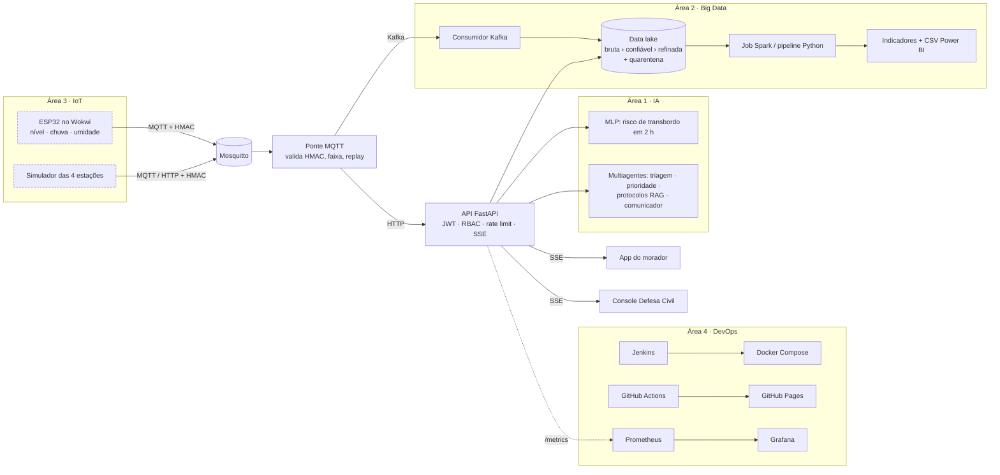

# Margem — alerta comunitário de enchentes

> FIAP · Global Solution 2026/2 · **CitizenTech** · Turma 4ESOA

Na várzea do Tietê, zona leste de São Paulo (Jardim Pantanal, Vila Itaim, Jardim Romano, Jardim Helena), a
água costuma chegar antes do aviso. O **Margem** junta estações de nível do rio, uma IA que prevê o
transbordo e um app simples para morador e Defesa Civil, para o aviso chegar **antes**, e o pedido de
ajuda de quem mais precisa chegar **primeiro**.

| | |
|---|---|
| **Site (demonstração)** | https://ryuzeen.github.io/margem-citizentech/ |
| **Vídeo pitch** | _LINK DO PITCH — preencher antes da entrega_ |
| **Repositório** | https://github.com/ryuzeen/margem-citizentech |
| **ODS** | 11 (cidades sustentáveis), 13 (ação climática), 10 (redução das desigualdades), 3 (saúde) |

> **Dados simulados.** Estações, leituras, histórico de 365 dias, relatos e moradores são simulados e
> estão marcados como simulados em todo lugar. Os números mostram o ganho do método, não desempenho em
> campo. Cotas e endereços não são oficiais.

## Grupo

| Nome | RM |
|---|---|
| Italo de Souza | 551500 |
| Victor Montenegro Borges | 98708 |
| Matheus Morete Espinoso | 552428 |
| Octávio Hernandez (Chiste Cordeiro) | 97894 |
| Rafael Perussi Caczan | 93092 |

---

## Como rodar (5 minutos, sem Docker)

Pré-requisito: **Python 3.10+** no PATH.

```bash
python iniciar.py
```

O script cria o `.venv`, instala as dependências, cria o `.env` com um segredo aleatório, gera o
histórico simulado e o data lake (se não existirem), treina o modelo de risco (se não existir), sobe a API
em **http://127.0.0.1:8080** e abre o navegador.

| Opção | O que faz |
|---|---|
| `--resetar` | apaga `dados/` e começa do zero (use antes de gravar o pitch) |
| `--sem-navegador` | não abre o navegador |
| `--so-preparar` | só instala e gera dados/modelo, sem subir a API |

**Logins de demonstração**

| Perfil | E-mail | Senha |
|---|---|---|
| Morador (app) | `maria@demo.margem.app` | `Margem@2026` |
| Defesa Civil (console) | `operador@demo.margem.app` | `DefesaCivil@2026` |

**Roteiro rápido da demo:** abra o console (`/console.html`) como Defesa Civil › **Estações IoT** ›
*Cenário de simulação* › **Enchente**. Em ~1 minuto o rio sobe, a IA emite o alerta sozinha, ele chega no app da Maria
(`/app.html`), ela pede ajuda e o pedido entra na fila priorizada do console. Um minuto do relógio da
demonstração equivale a 5 horas (300×).

Sem a API (por exemplo, no GitHub Pages), o front entra em **modo demonstração** e simula tudo no navegador.

---

## Arquitetura



Fluxo de ponta a ponta: leitura do sensor › validação (HMAC, anti-replay, faixa) › data lake ›
features › MLP prevê o risco › se o nível sobe para *alerta*, o agente comunicador redige o alerta
(SMS ≤ 160 caracteres) › SSE para o app › morador pede ajuda › multiagentes triam › fila priorizada no
console, com nome e telefone mascarados (LGPD).

Níveis (padrão da Defesa Civil): **observação › atenção › alerta › alerta máximo**. O nível final é o
maior entre a regra por cota da régua e a probabilidade do modelo (limiares 0,35 / 0,60 / 0,85).

### Estrutura

```
area1_ia/          IA: triagem de relatos, RAG, multiagentes, MLP de risco, avaliação
area2_bigdata/     histórico simulado, ingestão (MQTT/Kafka), pipeline, Spark, indicadores, Power BI
area3_mvp_iot/     api/ (FastAPI), web/ (app + console + landing), iot/ (firmware ESP32 + simulador)
area4_devops/      Jenkins, monitoramento, Mosquitto, segurança, plano de testes
comum/             config, território, níveis e assinatura HMAC compartilhados
config/            territorio.json (bairros, estações, cotas, abrigos, telefones)
docs/              contratos entre áreas, design, decisões, roadmap, erros corrigidos
entrega/           PITCH.md, evidências (prints), PDF e .txt da entrega
```

---

## Área 1 · IA e automação

Detalhes, prompts e arquitetura dos agentes: [`area1_ia/README.md`](area1_ia/README.md).
Relatório completo: [`area1_ia/avaliacao/saida/relatorio_ia.md`](area1_ia/avaliacao/saida/relatorio_ia.md).

- **Previsão de transbordo** — rede neural `MLPClassifier(32, 16)` sobre 10 features (nível, variação 1 h
  e 3 h, chuva 1/3/6/24 h, umidade do solo, % da cota, hora). Validação walk-forward.
- **Triagem multiagente** — Triagem (TF-IDF + regressão logística + léxico de vulneráveis + regras),
  Prioridade (gravidade × vulnerabilidade × risco do bairro × espera), Protocolos (RAG TF-IDF sobre 12
  documentos de orientação) e Comunicador (mensagem ao morador e alerta).
- **LLM opcional** (Ollama local); por padrão desligado, tudo roda offline e sem chave.

**Antes × depois** (dados simulados, walk-forward em 243 dias, 17 transbordos):

| | Regra por cota (antes) | **Margem (MLP + cota)** |
|---|---|---|
| Antecedência média do aviso | 162 min | **222 min** |
| Enchentes avisadas ≥ 2 h antes | 24% | **82%** |
| Falsos alarmes por mês | 2,2 | 2,8 |
| Triagem: acerto da categoria | 62% (palavra-chave) | **87%** |
| Triagem: recall de casos graves | 24% | **70%** |

```bash
.venv/Scripts/python -m area1_ia.avaliacao     # regenera relatório, métricas, gráficos e exemplos de entrada/saída
.venv/Scripts/python -m pytest area1_ia
```

## Área 2 · Big Data

- **Histórico simulado** de 365 dias (05/11/2025 a 04/11/2026), 4 estações, modelo hidrológico próprio
  (46 transbordos e 33 quase-enchentes).
- **Data lake** em camadas: `bruta` (JSONL por dia e origem) › `confiavel` (validado, deduplicado) ›
  `refinada` (leituras por hora, risco por bairro, indicadores) e `quarentena` com o motivo de cada rejeição.
- **Ingestão em streaming**: ESP32/simulador › MQTT › ponte › **Kafka** › consumidor › data lake.
- **Processamento**: pipeline incremental em Python (modo leve) e o mesmo pipeline em **Spark** (modo completo).
- **Indicadores** (6) para o dashboard do console e para o **Power BI** (PBIP com 26 medidas DAX,
  [`area2_bigdata/powerbi/README.md`](area2_bigdata/powerbi/README.md)). Medidas: [`MEDIDAS.md`](area2_bigdata/analytics/MEDIDAS.md).

```bash
.venv/Scripts/python -m area2_bigdata.historico.gerar          # histórico simulado (365 dias)
.venv/Scripts/python -m area2_bigdata.processamento --completo # bruta › confiável › refinada
.venv/Scripts/python area2_bigdata/powerbi/atualizar_dados.py  # CSVs para o Power BI
docker compose --profile completo run --rm spark-job           # mesmo pipeline em Spark
.venv/Scripts/python -m pytest area2_bigdata
```

## Área 3 · MVP e IoT

- **App do morador** (`/app.html`): risco do bairro em tempo real (régua), alertas, "estou bem / preciso
  de ajuda", relato livre com orientação imediata, abrigos no mapa, acessibilidade (fonte, contraste,
  leitura em voz alta). Instalável (PWA).
- **Console da Defesa Civil** (`/console.html`): fila priorizada pela IA, check-ins, rascunho e emissão
  de alertas, dashboard com os 6 indicadores, controle da simulação.
- **API** FastAPI: documentação interativa em http://127.0.0.1:8080/api/docs.
- **Firmware ESP32** (C++, Wokwi): nível do rio por ultrassom (HC-SR04), chuva e umidade do solo por
  potenciômetros, display OLED, LEDs verde/amarelo/vermelho e buzzer por nível,
  MQTT com assinatura HMAC-SHA256 e número de sequência anti-replay. Passo a passo:
  [`area3_mvp_iot/iot/firmware/README.md`](area3_mvp_iot/iot/firmware/README.md).
  Projeto no Wokwi: _LINK DO WOKWI — preencher_.
- **Simulador** das 4 estações (cenários normal, chuva forte, enchente):

```bash
.venv/Scripts/python -m area3_mvp_iot.iot.simulador --cenario enchente --api http://127.0.0.1:8080
.venv/Scripts/python -m area2_bigdata.ingestao.ponte_mqtt --api http://127.0.0.1:8080   # recebe o ESP32 do Wokwi
.venv/Scripts/python -m pytest area3_mvp_iot
```

## Área 4 · DevOps, cloud e segurança

Modo completo com Docker (Docker Desktop ligado):

```bash
docker compose up -d --build                          # só a aplicação (http://localhost:8080)
docker compose --profile completo up -d --build       # + Mosquitto, Kafka, ponte, consumidor, simulador, Prometheus, Grafana
docker compose --profile cicd up -d --build jenkins   # Jenkins (http://localhost:8081)
docker compose --profile completo --profile cicd down # derruba tudo
```

| Serviço | Endereço | Acesso |
|---|---|---|
| App + API | http://localhost:8080 | logins de demonstração acima |
| Grafana | http://localhost:3000 | leitura anônima; admin `admin` / `margem-grafana` |
| Prometheus | http://localhost:9090 | — |
| Jenkins | http://localhost:8081 | `admin` / `margem-jenkins` |

- **CI/CD com Jenkins** ([`Jenkinsfile`](Jenkinsfile), configurado por código em
  [`area4_devops/jenkins/casc.yaml`](area4_devops/jenkins/casc.yaml)): consulta o GitHub a cada 2 min e, a
  cada commit, roda ambiente › lint › testes (JUnit + cobertura) › build da imagem › deploy
  (`docker compose up`) › smoke test.
- **GitHub Actions** ([`.github/workflows/ci.yml`](.github/workflows/ci.yml)): testes, build da imagem e
  deploy do site no GitHub Pages.
- **Monitoramento**: a API expõe `/metrics` (requisições, latência, leituras aceitas/recusadas, nível por
  estação, risco por bairro, alertas, ocorrências, clientes em tempo real); Prometheus coleta e tem regras
  de alerta; Grafana mostra o painel "Margem".
- **Segurança** — 10 práticas mapeadas para código e testes em
  [`area4_devops/SEGURANCA.md`](area4_devops/SEGURANCA.md): bcrypt, JWT, RBAC, rate limit, validação
  estrita (Pydantic), HMAC + anti-replay nas estações, cabeçalhos (CSP etc.), mascaramento LGPD,
  consentimento no cadastro, contêiner sem root.
- **Plano de testes**: [`area4_devops/testes/PLANO_DE_TESTES.md`](area4_devops/testes/PLANO_DE_TESTES.md).

```bash
.venv/Scripts/python -m pytest -m "not e2e"   # unitários + integração (123 testes)
.venv/Scripts/python -m pytest -m e2e         # ponta a ponta no navegador (Playwright)
.venv/Scripts/python -m ruff check .
```

---

## Tecnologias × conteúdo do curso (até a fase 7)

| Tecnologia | Onde | Fase |
|---|---|---|
| Python, pandas, scikit-learn, redes neurais (MLP) | área 1 e 2 | F1–F2 |
| Engenharia de prompt, LLM local opcional | área 1 | F3 |
| RAG | área 1 | F4 |
| Multiagentes | área 1 | F6 |
| Spark, Kafka, data lake em camadas | área 2 | F4–F5 |
| DAX / Power BI | área 2 | F6–F7 |
| Simulador de hardware (Wokwi), ESP32, C/C++, MQTT | área 3 | F3–F5 |
| Segurança em IoT e aplicações | áreas 3 e 4 | F4–F5 |
| Docker, Jenkins, CI/CD, monitoramento | área 4 | F4–F7 |

Decisões e justificativas: [`docs/DECISOES.md`](docs/DECISOES.md).

## Uso de IA generativa

Declaração exigida pelo regulamento da Global Solution.

| Ferramenta | Para quê |
|---|---|
| Claude (Anthropic), via Claude Code | apoio no planejamento da arquitetura, geração e revisão de partes do código, explicação de erros, revisão de texto da documentação e do roteiro do pitch |

Como usamos: todo código e texto gerado com apoio da ferramenta foi lido, executado e revisado pelo grupo
antes de entrar no repositório; os resultados foram conferidos rodando os testes (123 automatizados + E2E)
e a aplicação. Decisões de produto, escolha do problema, validação com moradores e o vídeo pitch são do
grupo. A IA **dentro** do produto (área 1) é própria e roda offline: modelos treinados por nós com
scikit-learn, sem chamada a serviço externo.

## Créditos

- Mapa: [Leaflet](https://leafletjs.com) (BSD-2) e dados © [OpenStreetMap](https://www.openstreetmap.org/copyright) (ODbL).
- Ícones: [Lucide](https://lucide.dev) (ISC).
- Fontes: Atkinson Hyperlegible Next (Braille Institute, OFL), Archivo e IBM Plex Mono (OFL).
- Contexto do problema: reportagens do Brasil de Fato sobre as enchentes do Jardim Pantanal (2020 e 14/09/2026).
- Níveis de alerta inspirados no padrão da Defesa Civil do Estado de São Paulo.
