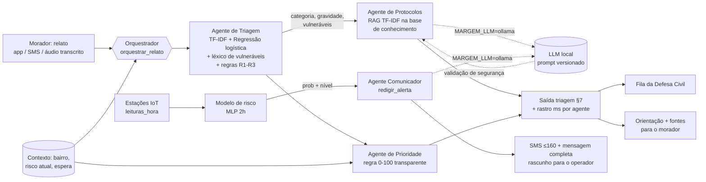

# Área 1 - IA e automação (Margem)

IA que resolve duas partes reais do problema da enchente na várzea do Tietê:

1. **Prever o transbordo antes** que a régua chegue na cota (rede neural MLP sobre as leituras das estações).
2. **Triar os pedidos de ajuda** dos moradores e entregar à Defesa Civil uma fila priorizada, com
   orientação imediata ao morador baseada em protocolos oficiais (sistema multiagente + RAG).

Tudo roda **offline, sem chave de API e sem GPU**. Um LLM local (Ollama) é opcional.

> **Dados simulados.** Os relatos de treino são gerados por template, o conjunto de teste foi escrito
> à mão pela equipe e as leituras de sensor vêm do histórico simulado da área 2 (e de uma fixture própria).
> As métricas mostram o ganho do método, não desempenho em campo.

## Como rodar (a partir da raiz do repositório)

```bash
.venv/Scripts/python -m area1_ia.avaliacao            # gera relatório, métricas, PNGs e exemplos
.venv/Scripts/python -m area1_ia.modelo_risco.treinar # treina o MLP no data_lake/refinada/leituras_hora.parquet
.venv/Scripts/python -m area1_ia.modelo_risco.treinar --fixture   # idem, sem o parquet (dados sintéticos)
.venv/Scripts/python -m area1_ia.triagem.gerar_dataset            # regenera o dataset de treino (templates)
.venv/Scripts/python -m area1_ia.triagem.treinar                  # re-treina o classificador de relatos
.venv/Scripts/python -m pytest area1_ia                           # testes
```

Uso pelas outras áreas (contrato `docs/CONTRATOS.md` §6):

```python
from area1_ia.agentes import orquestrar_relato, redigir_alerta
from area1_ia.modelo_risco import prever_risco

orquestrar_relato("a água tá no joelho e minha vó é acamada",
                  {"bairro_id": "jardim-pantanal", "risco_bairro": {"nivel": "alerta", "prob": 0.7}, "espera_min": 15})
redigir_alerta({"id": "jardim-pantanal"}, {"nivel": "alerta", "prob": 0.72})
prever_risco({"estacao_id": "EST-PANTANAL-01", "nivel_cm": 240, "nivel_var_1h": 18, "chuva_3h": 45})
# prever_risco também aceita uma lista de leituras (histórico recente) e calcula as features que faltarem
```

## Arquitetura multiagente



Cada chamada devolve `rastro` com o agente, o tempo em ms e um resumo da saída, para auditoria
(ex.: `prioridade: 78 = G37.5 + V20 + R20 (alerta_maximo) + E0.8`).

### 1. Agente de Triagem (`agentes/triagem.py`, `triagem/`)
- **Modelo**: TF-IDF de palavras (1-2 gramas) + n-gramas de caracteres (2-5, aguenta erro de digitação e
  gíria) -> `LogisticRegression` (class_weight balanceado). Dois modelos: **categoria** (6 classes do
  contrato) e **gravidade** (1-5). Texto normalizado (minúsculo, sem acento, "socorrooo" -> "socorroo").
- **Vulneráveis** (`triagem/vulneraveis.py`): léxico + regex para idoso, pcd, criança, gestante, acamado
  (vó, vozinha, velhinho, "senhora de 82 anos", cadeirante, autista, muleta, nenem, recém-nascido, grávida,
  "tô de 8 meses", acamado, de cama, oxigênio...), com **negação** ("não tem criança aqui" não conta).
- **Regras de segurança** aplicadas por cima do ML (por isso `modo = "ml+regras"`):
  - **R1** termos de risco de vida (arrastado, telhado, forro, desabou, soterrado, choque, afogando...)
    -> gravidade mínima 5 (ilhada/estrutural/energia) ou 4 (demais).
  - **R2** pessoa ilhada nunca fica abaixo de gravidade 4.
  - **R3** "ilhado", "preso em casa", "não consegue sair" -> categoria pessoa_ilhada.
  - **R4** gravidade sempre entre 1 e 5.
- Rubrica de gravidade (mesma no treino e no teste): 1 dúvida/informação; 2 transtorno leve;
  3 dano material/água dentro de casa; 4 risco à integridade (água alta, fio na água, muro cedendo, ilhado);
  5 risco de vida imediato (arrastado, telhado, desabamento com pessoas, choque).

### 2. Agente de Protocolos (`agentes/protocolos.py`, `rag/`)
- **Base de conhecimento** `rag/base_conhecimento/*.md`: 12 documentos curtos escritos pela equipe com
  base em orientações públicas da Defesa Civil de SP, Corpo de Bombeiros PMESP, Ministério da Saúde e
  Cemaden (antes/durante/depois, vulneráveis, energia, água e alimentos, leptospirose, abrigos, telefones,
  pessoa ilhada, risco estrutural, níveis de alerta). Cada um tem a seção **Fonte**.
- **Indexação**: cada seção `##` vira um trecho (45 no total); TF-IDF de palavras + n-gramas de caracteres,
  similaridade de cosseno, top-k com doc, título e trecho.
- **Regras de automação**: a consulta é o relato + termos da categoria + termos dos vulneráveis
  (expansão de consulta); o documento principal da categoria ganha bônus no ranking; no máximo 2 trechos
  por documento; caso grave (gravidade >= 4 ou ilhado) sempre começa com "ligue 193 ou 199".
- Sem LLM: orientação montada com as primeiras frases dos trechos + frase específica para o vulnerável.
- Com LLM: prompt `prompts/protocolos_orientacao.md`; a resposta é **descartada** se citar telefone fora
  da lista (190/192/193/199/40199) ou for curta demais; se faltar 193/199 em caso grave, o código acrescenta.

### 3. Agente de Prioridade (`agentes/prioridade.py`)
`prioridade = G + V + R + E` (0 a 100), regra aberta e explicável no rastro:

| componente | cálculo | faixa |
|---|---|---|
| G gravidade | (gravidade - 1) / 4 × 50 | 0-50 |
| V vulneráveis | acamado 12, pcd 10, idoso 8, gestante 8, criança 8 (soma, teto 20) | 0-20 |
| R risco do bairro | observação 0, atenção 6, alerta 13, alerta máximo 20 (ou derivado de `prob`) | 0-20 |
| E espera | 2 pontos a cada 12 min de espera (teto 10) | 0-10 |

Pesos definidos pela equipe (premissa do projeto, não norma oficial).

### 4. Agente Comunicador (`agentes/comunicador.py`, `redigir_alerta`)
- Título, **SMS de no máximo 160 caracteres** (testado para todos os bairros e níveis; nomes longos viram
  "Jd." e há versões mais curtas do texto) e mensagem completa com "O que fazer agora:", ponto de apoio
  do bairro (de `config/territorio.json`, simulado) e telefones.
- Tom calmo, verbos no imperativo, frases curtas; 193/199 sempre presentes em Alerta e Alerta máximo.
- Com LLM: prompt `prompts/comunicador_alerta.md` com saída JSON; descartado se passar de 160 caracteres,
  faltar "O que fazer agora", citar telefone não permitido ou omitir 193/199 nos níveis altos.

### 5. Modelo de risco - rede neural (`modelo_risco/`)
- Features (contrato §5): nível, variação 1h/3h, chuva 1/3/6/24h, umidade do solo, % da cota de alerta, hora.
- `StandardScaler -> MLPClassifier(32, 16)` com early stopping; alvo `transbordo_2h`.
- **Split temporal** (85% treino / 15% teste final) + **walk-forward** (cada bloco testado com modelo treinado
  só no passado). Desbalanceamento (~1% de horas positivas): oversampling dos positivos com ruído até 25%.
- **Limiar**: maior F2 na validação cruzada temporal (recall pesa 2×: perder uma enchente custa mais que um
  alarme), com precisão mínima de 0,30. A `prob` devolvida é reescalada por partes para que o limiar
  coincida com o corte de Alerta (0,60) do contrato §3 - não é probabilidade calibrada.
- `prever_risco` usa `comum.niveis.nivel_final` (maior entre cota e modelo). Sem `modelo.joblib`, cai numa
  regra logística simples e devolve `"modelo": "regra"`.

## Prompts e LLM opcional (`prompts/`)
| arquivo | agente | versão |
|---|---|---|
| `protocolos_orientacao.md` | Protocolos | 1.0.0 |
| `comunicador_alerta.md` | Comunicador | 1.0.0 |

Cada prompt tem cabeçalho (versão, data, modelo, quando é usado), objetivo, tabela de entradas, formato de
saída, regras de segurança (não inventar endereço/telefone/promessa de resgate, sempre 193/199 em
emergência, sem diagnóstico) e os blocos `sistema`/`usuario` lidos pelo código. Para ligar:

```
MARGEM_LLM=ollama
MARGEM_OLLAMA_URL=http://127.0.0.1:11434
MARGEM_OLLAMA_MODELO=llama3.2:3b
MARGEM_LLM_TIMEOUT=8          # opcional, segundos
```

Qualquer erro (Ollama desligado, timeout, resposta inválida) volta ao caminho determinístico. `modo = "llm"`
só aparece quando o LLM respondeu e a resposta passou nas validações.

## Métricas (resumo de `avaliacao/saida/relatorio_ia.md`)

**Triagem** - 581 relatos de treino (templates) x **94 relatos de teste escritos à mão**:

| | categoria F1 macro | gravidade F1 macro | gravidade ±1 | recall graves (4-5) | vulneráveis F1 |
|---|---|---|---|---|---|
| Antes: palavra-chave | 0,64 | 0,25 | 0,71 | 0,24 | 0,64 |
| **Margem: ML + regras** | **0,87** | **0,58** | **0,89** | **0,70** | **0,97** |

**RAG** - 20 perguntas com documento esperado: acerto no 1º resultado 0,80; no top 3 1,00.

**Risco de transbordo** (antes = alerta quando nível >= cota de alerta):

| dados | sistema | antecedência média | avisados >= 1 h antes | falsos alarmes/mês |
|---|---|---|---|---|
| histórico área 2 (365 dias, 17 transbordos, walk-forward) | regra por cota | 162 min | 71% | 2,2 |
| | **Margem (MLP + cota)** | **222 min** | **100%** | 2,8 |
| | MLP sozinho | 95 min | 82% | **1,2** |
| fixture 2 anos (16 transbordos) | regra por cota | 112 min | 100% (50% com >= 2 h) | 4,9 |
| | **Margem (MLP + cota)** | **158 min** | 100% (94% com >= 2 h) | 4,9 |
| | MLP sozinho | 135 min | 100% (94% com >= 2 h) | **1,4** |

**Ganho operacional** (lote simulado, 30 × 40 relatos do teste): casos críticos (gravidade >= 4 com
vulnerável) sobem da posição média 20,6 (ordem de chegada) para 11,0; no top 10 passam de 23% para 55%.
Triagem automática ~3 ms por relato x 2-4 min na triagem manual (premissa da equipe, não dado oficial).

## Limitações (honestas)
- Treino de triagem por template e teste escrito pela equipe: o desempenho com relatos reais será menor.
- Gravidade é subjetiva e é o ponto fraco (F1 0,58); as regras R1/R2 protegem os casos de risco de vida.
- O léxico de vulneráveis não entende contexto longo nem doenças ("sogra com alzheimer" não vira idoso).
- O histórico da área 2 é simulado (365 dias, 17 transbordos no teste); os números por evento têm margem de erro grande.
  A fixture é física simplificada (com uma onda de montante não observada para não ficar trivial).
- O Margem em produção usa o maior nível entre cota e modelo (contrato §3): herda os falsos alarmes da cota.
- A prioridade usa pesos definidos pela equipe; precisam ser calibrados com a Defesa Civil.
- A IA não substitui o operador: ordena a fila e sugere textos, que são revisados antes de emitir.

## Arquivos
```
agentes/        orquestrador.py, triagem.py, protocolos.py, prioridade.py, comunicador.py, llm.py
triagem/        gerar_dataset.py, dados_rotulados.csv (treino), teste_manual.csv (teste à mão),
                modelo.py, baseline.py, vulneraveis.py, treinar.py, modelo_triagem.joblib
rag/            buscador.py, base_conhecimento/*.md (12 documentos)
modelo_risco/   fixture.py, treinar.py, avaliar.py, prever.py, modelo.joblib, metricas.json
prompts/        protocolos_orientacao.md, comunicador_alerta.md
avaliacao/      __main__.py, graficos.py, saida/ (relatorio_ia.md, metricas_ia.json, exemplos_entrada_saida.json, PNGs)
tests/          test_agentes.py, test_modelo_risco.py
```
