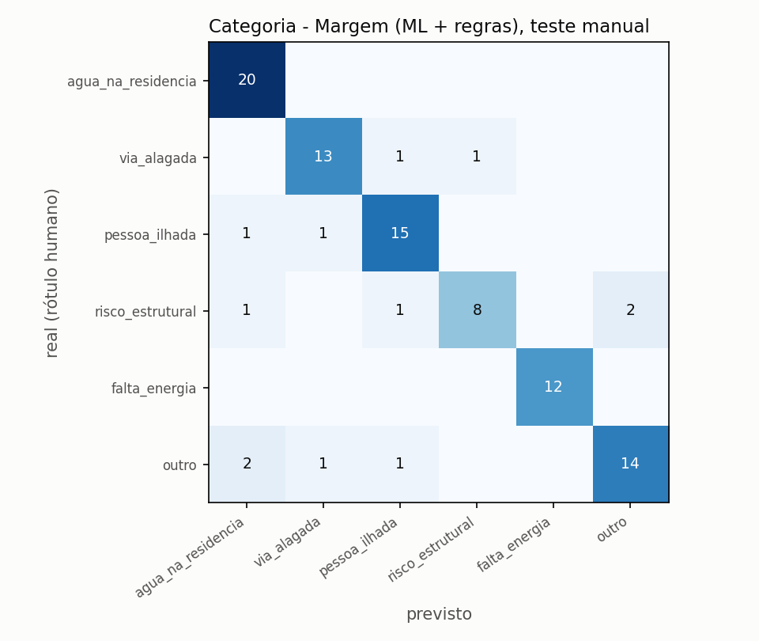
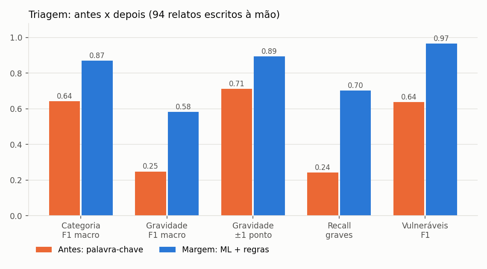
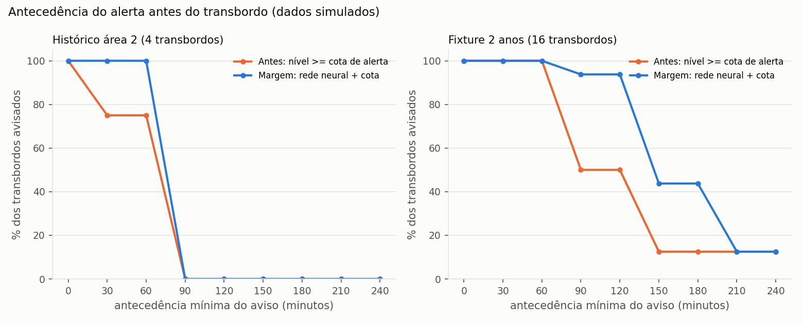
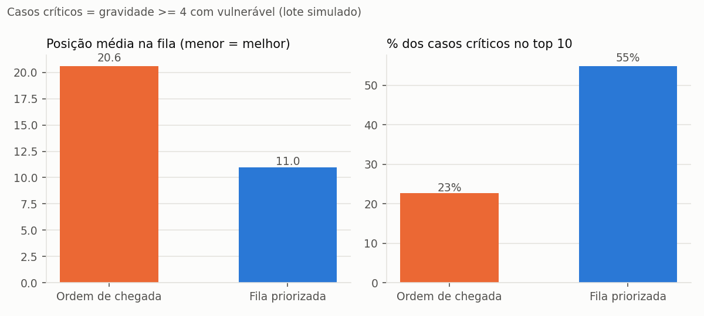

# Relatório de IA - Margem (área 1)

Gerado em 05/11/2026 14:22 por `python -m area1_ia.avaliacao`.
**Todos os dados de treino são simulados** (relatos por template; leituras de sensor do histórico simulado da área 2 e de uma fixture sintética própria). Os números mostram o ganho do método, não desempenho em campo.

## 1. Triagem de relatos (antes x depois)
Treino: 581 relatos gerados por template. Teste: **94 relatos escritos à mão** (sem template), 37 deles com gravidade 4-5.

| sistema | categoria acurácia | categoria F1 macro | gravidade acurácia | gravidade F1 macro | gravidade ±1 | recall graves (4-5) | vulneráveis F1 | vulneráveis exato |
|---|---|---|---|---|---|---|---|---|
| Antes: palavra-chave | 0,617 | 0,642 | 0,319 | 0,249 | 0,713 | 0,243 | 0,638 | 0,819 |
| ML sem regras | 0,851 | 0,849 | 0,521 | 0,547 | 0,872 | 0,649 | 0,967 | 0,979 |
| **Margem: ML + regras** | 0,872 | 0,870 | 0,553 | 0,583 | 0,894 | 0,703 | 0,967 | 0,979 |

## 2. RAG (base de conhecimento)
20 perguntas escritas à mão com o documento correto esperado: acerto no 1º resultado **0,800**, no top 3 **1,000**, MRR 0,900.

## 3. Risco de transbordo em 2 h (rede neural MLP x regra por cota)
### 3.1 Histórico da área 2 (data_lake/refinada/leituras_hora.parquet (histórico simulado, área 2))
8587 leituras horárias de 2026-08-07 a 2026-11-04. Limiar escolhido: **0.73** - maior F2 na validação cruzada temporal (1.000, precisão 1.000, mínimo exigido 0.3); F2 pesa o recall 2x porque deixar de avisar um transbordo custa mais que um alarme a mais.

Walk-forward (4 blocos de teste, cada um com modelo treinado só no passado; 2026-09-06 a 2026-11-04). Por hora (rótulo `transbordo_2h`):

| sistema | acurácia | precisão | recall | F1 | ROC-AUC |
|---|---|---|---|---|---|
| Antes: nível >= cota de alerta | 0,996 | 0,612 | 0,857 | 0,714 | - |
| MLP sozinho | 0,998 | 0,929 | 0,743 | 0,825 | 0,971 |
| **Margem: MLP + cota (como roda)** | 0,996 | 0,608 | 0,886 | 0,721 | - |

Por evento (4 transbordos, 60.0 dias de teste, 4 estações):

| sistema | antecedência média | avisados >= 1 h antes | avisados >= 2 h antes | falsos alarmes/mês |
|---|---|---|---|---|
| Antes: nível >= cota de alerta | 45 min | 0,750 | 0,000 | 0.0 |
| MLP sozinho | 60 min | 1,000 | 0,000 | 0.5 |
| **Margem: MLP + cota (como roda)** | 60 min | 1,000 | 0,000 | 0.5 |

Holdout (15% finais, 2026-10-22 a 2026-11-04; é o modelo salvo):

| sistema | acurácia | precisão | recall | F1 | ROC-AUC |
|---|---|---|---|---|---|
| Antes: nível >= cota de alerta | 0,981 | 0,612 | 0,857 | 0,714 | - |
| MLP sozinho | 0,995 | 0,967 | 0,829 | 0,892 | 0,971 |
| **Margem: MLP + cota (como roda)** | 0,983 | 0,627 | 0,914 | 0,744 | - |

Por evento (4 transbordos, 13.5 dias de teste, 4 estações):

| sistema | antecedência média | avisados >= 1 h antes | avisados >= 2 h antes | falsos alarmes/mês |
|---|---|---|---|---|
| Antes: nível >= cota de alerta | 45 min | 0,750 | 0,000 | 0.0 |
| MLP sozinho | 75 min | 1,000 | 0,250 | 0.0 |
| **Margem: MLP + cota (como roda)** | 75 min | 1,000 | 0,250 | 0.0 |

### 3.2 Fixture sintética própria (2 anos, mais eventos)
Mesmo método, holdout nos 15% finais. Limiar 0.56.

| sistema | acurácia | precisão | recall | F1 | ROC-AUC |
|---|---|---|---|---|---|
| Antes: nível >= cota de alerta | 0,973 | 0,291 | 0,934 | 0,444 | - |
| MLP sozinho | 0,997 | 0,819 | 0,975 | 0,891 | 1,000 |
| **Margem: MLP + cota (como roda)** | 0,973 | 0,299 | 0,992 | 0,460 | - |

Por evento (16 transbordos, 109.5 dias de teste, 4 estações):

| sistema | antecedência média | avisados >= 1 h antes | avisados >= 2 h antes | falsos alarmes/mês |
|---|---|---|---|---|
| Antes: nível >= cota de alerta | 112 min | 1,000 | 0,500 | 4.93 |
| MLP sozinho | 135 min | 1,000 | 0,938 | 1.37 |
| **Margem: MLP + cota (como roda)** | 158 min | 1,000 | 0,938 | 4.93 |

Leitura honesta: o Margem em produção usa o MAIOR nível entre cota e modelo (contrato §3), então herda os falsos alarmes da regra por cota; o ganho dele é antecedência. O MLP sozinho mostra quanto daria para reduzir falsos alarmes se a Defesa Civil alertasse só pelo modelo. O histórico da área 2 tem poucos transbordos (90 dias), então os números de evento ali têm margem de erro grande.

## 4. Ganho operacional
**Fila**: 30 lotes simulados de 40 relatos do conjunto de teste, 233 casos críticos (gravidade real >= 4 com vulnerável), nível de risco do bairro sorteado, 1 relato a cada 1,5 min.

| fila | posição média dos críticos | % dos críticos no top 10 |
|---|---|---|
| Ordem de chegada (FIFO) | 20.6 | 22.7% |
| **Priorizada pelo Margem** | 11.0 | 54.9% |

**Tempo de triagem**: 2.6 ms por relato em média (p95 2.9 ms, 94 relatos, CPU comum, sem LLM). Premissa da equipe (não é dado oficial): triagem manual em plantão leva 2 a 4 min por relato. Lote de 100 relatos: 200-400 min manual x 0.26 s automático (o operador continua revisando; a IA ordena a fila e sugere a orientação).

## 5. Limitações
- Relatos de treino gerados por template; o teste manual foi escrito pela equipe, não por moradores reais.
- Leituras de sensor simuladas; a rede neural precisa ser re-treinada com série real antes de uso real.
- Gravidade é a tarefa mais difícil (escala subjetiva); por isso existem as regras de piso (R1/R2).
- O léxico de vulneráveis não entende contexto longo (ex.: 'minha sogra tem alzheimer' não vira idoso).

Exemplos completos de entrada e saída: `exemplos_entrada_saida.json`.
